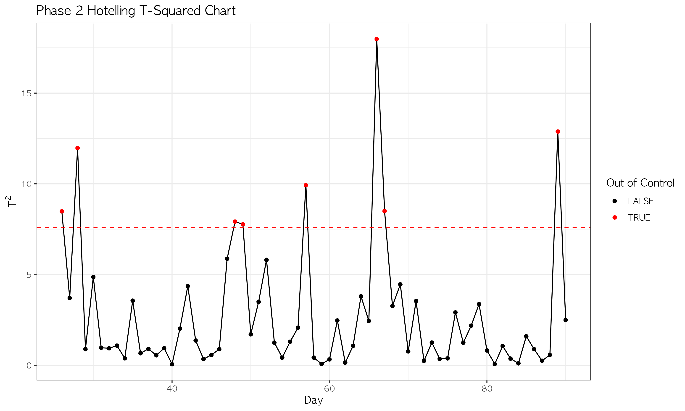

# 통계적 공정관리(SPC)를 활용한 콜센터 이상치 탐지

> 통신사 콜센터의 일별 **미응대율**과 **미해결률**을 SPC 관리도로 모니터링했습니다.
> **결론: 단변량 관리도(p, CUSUM, EWMA)는 신호를 하나도 잡지 못했지만, 두 지표를 함께 보는 Hotelling T² 관리도는 Phase 2에서 이상일 8일을 탐지했습니다.**

- 사용 도구: R (`qcc`, `spc`, `MSQC`, `ggplot2`)
- 📄 [분석 보고서 (PDF)](report.pdf)



## 핵심 결과

| 관리도 | 대상 | Phase 2 이상 신호 |
|---|---|---|
| p-관리도 (변량 표본) | 미응대율, 미해결률 각각 | 0건 |
| CUSUM (k = 0.25, h = 5) | 미응대율, 미해결률 각각 | 0건 |
| EWMA (λ = 0.8 / 0.5 / 0.2, ARL₀ = 370) | 미응대율, 미해결률 각각 | 0건 |
| **Hotelling T²** | **두 지표 동시** | **8건** |

- 각 지표만 따로 보면 모든 날이 관리한계 안에 있었습니다.
- 두 지표를 **결합해서** 보면 정상 범위에서 벗어난 날이 드러났습니다. 예를 들어 3/07은 미응대율은 높은데 미해결률은 낮았고, 1/26은 두 지표가 모두 이례적으로 낮았습니다.
- 이처럼 **지표 간 상관 구조가 깨지는 이상**은 다변량 관리도로만 탐지할 수 있습니다. 탐지된 날짜는 [`hotelling_phase2_outliers.csv`](outputs/tables/hotelling_phase2_outliers.csv)에 정리했습니다.

| 날짜 | 미응대율 | 미해결률 |
|---|---|---|
| 2021-01-26 | 0.117 | 0.019 |
| 2021-01-28 | 0.071 | 0.096 |
| 2021-02-17 | 0.191 | 0.218 |
| 2021-02-18 | 0.260 | 0.189 |
| 2021-02-26 | 0.232 | 0.233 |
| 2021-03-07 | 0.333 | 0.063 |
| 2021-03-08 | 0.089 | 0.098 |
| 2021-03-30 | 0.360 | 0.125 |

Phase 1 평균은 미응대율 0.185, 미해결률 0.102입니다.

## 데이터

- **Telecom Company Call-Center Dataset**: 2021년 1 ~ 3월 통화 5,000건
- 일 단위로 집계해 두 품질특성을 만들었습니다.
  - 미응대율 = 미응대 건수 / 전체 문의 수
  - 미해결률 = 미해결 건수 / 응대 건수
- **Phase 1** (기준선 설정): 2021-01-01 ~ 01-25, 25일
- **Phase 2** (모니터링): 2021-01-26 ~ 03-31, 65일

## 분석 절차

1. **p-관리도**: 일별 문의 수가 다르기 때문에 변량 표본 관리한계를 사용했습니다.
2. **CUSUM / EWMA**: Phase 1 기준으로 표준화한 뒤 작은 평균 이동을 탐지했습니다. EWMA는 λ별로 ARL₀ = 370에 맞춰 관리한계를 계산했습니다.
3. **Hotelling T²**:
   - Phase 1에서 이상점(10일, 22일)을 제거해 기준선을 정제했습니다.
   - 정제한 기준선의 F 분포 기반 UCL(7.58)로 Phase 2를 모니터링했습니다.
   - 이상점을 반복 제거하는 방식도 함께 비교했습니다.

## 실행

```bash
Rscript main.R   # 레포 루트에서 실행
```

- 필요 패키지: `readxl`, `dplyr`, `lubridate`, `qcc`, `zoo`, `ggplot2`, `knitr`, `tibble`, `spc`, `MSQC`
- 파라미터(기간, CUSUM k/h, EWMA λ 등)는 [`config.R`](config.R)에서 바꿀 수 있습니다.
- 한글 폰트는 기본값이 AppleGothic입니다. Windows에서는 `FONT_FAMILY`를 바꿔 주세요.

```
├── main.R                 # 전체 파이프라인
├── config.R               # 경로·기간·파라미터
├── scripts/01 ~ 05_*.R    # 전처리 → Phase 1 → p → CUSUM/EWMA → Hotelling T²
├── utils/helper_functions.R
├── data/                  # 원본 데이터 (xlsx)
├── outputs/figures, tables
└── report.pdf             # 분석 보고서
```

## 참고문헌

- Montgomery, D. C. (2018). *Introduction to Statistical Quality Control* (7th ed.). Wiley.
